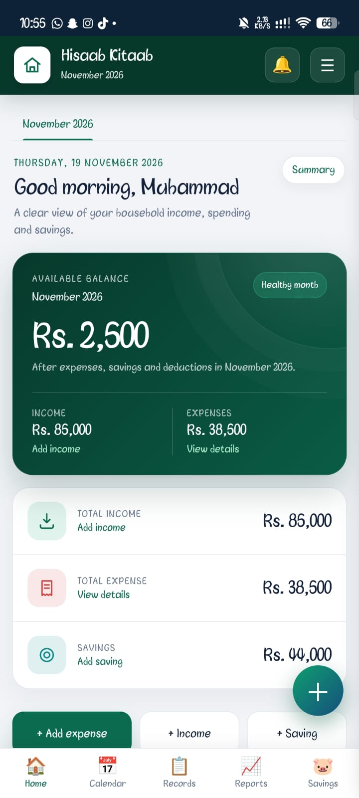
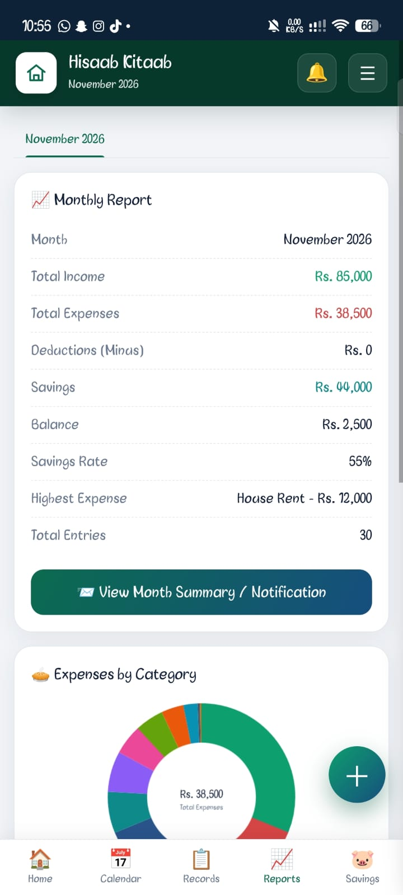
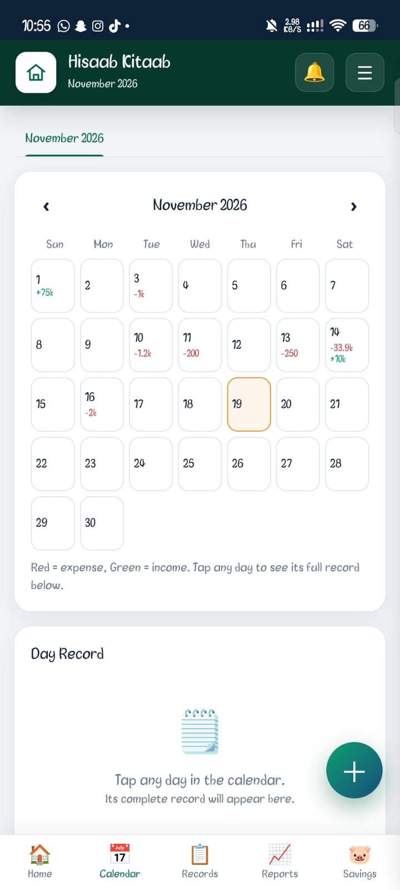
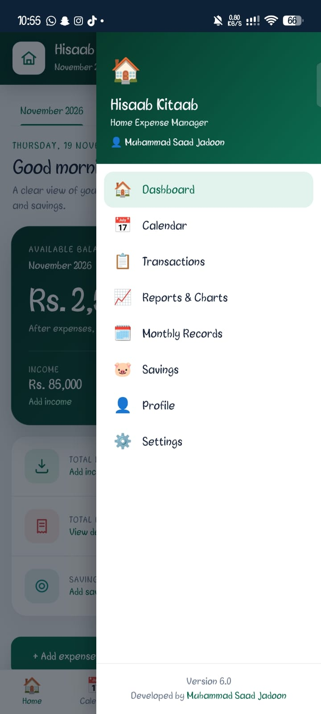

<div align="center">
  

  # Hisaab Kitaab

  **A simple, private way to manage everyday finances.**

  Track income, expenses and savings — all on your Android device.

  
  
  
  
</div>

---

## App Preview

<div align="center">
  
  &nbsp;
  
  &nbsp;
  
  &nbsp;
  
  <p><sub>Dashboard &nbsp;·&nbsp; Reports &nbsp;·&nbsp; Calendar &nbsp;·&nbsp; Navigation</sub></p>
</div>

## About

**Hisaab Kitaab** is an offline Android personal and household finance manager. Record daily transactions, see your monthly balance, explore spending reports and export your records — without creating an account.

### Highlights

- **Daily tracking:** Income, expenses, savings and deductions.
- **At-a-glance dashboard:** Balance, monthly totals and recent activity.
- **Calendar & reports:** Review transactions by date, category and month.
- **Data portability:** Export PDF, Excel and CSV; backup and restore with JSON.
- **Offline by design:** Records are stored on-device, with no account required.

## Download & Install

Download the included **[Hisaab Kitaab v6.0 APK](release/HisaabKitaab-v6.0.apk)** (Android 7.0 or newer), or install it using Android Debug Bridge:

```bash
adb install -r release/HisaabKitaab-v6.0.apk
```

> **Before updating:** Back up your records. Android only allows in-place updates when the signing certificate matches the installed app.

## Build From Source

**Requirements:** JDK 17, Android SDK Platform 34, Build-Tools 34.0.0, Bash and `zip`. The project uses a command-line build script, **not Gradle**.

```bash
# Install SDK packages (after installing Android SDK command-line tools)
sdkmanager "platforms;android-34" "build-tools;34.0.0" "platform-tools"

# Point to your local SDK installation
export ANDROID_SDK_ROOT="$HOME/Android/Sdk"

# Run from the project root
chmod +x build.sh
./build.sh

# Output: dist/HisaabKitaab.apk
The prebuilt APK shipped in this repository is `release/HisaabKitaab-v6.0.apk` (same v6.0 build).
```

On Windows, use Git Bash or WSL with a compatible SDK installation. The build script asks for a keystore password when needed; if no keystore exists, it creates one. **Never commit signing keys or passwords.** A newly generated key cannot update the supplied APK in place.

To check the supplied APK and its matching source asset:

```bash
python3 scripts/verify_release.py
```

The supplied APK passed the included archive/source consistency checks. A fresh rebuild and real-device test were **not** performed in this environment; see [verification details](docs/VERIFICATION.md).

## Manual QA checklist
Before a release, run these checks on a real Android device:
- [ ] Install the APK and open the dashboard
- [ ] Add one income, one expense and one saving entry, and check the totals
- [ ] Open Calendar, Reports and Monthly Records
- [ ] Export PDF, Excel and CSV, and back up / restore JSON
- [ ] Check back navigation, dark mode and settings

## Tech Stack

**Java · Android WebView · HTML · CSS · JavaScript · Android SDK**

The native Java activity hosts the bundled offline interface in `app/src/main/assets/index.html`. Transaction data is held locally using WebView storage and Android preferences.

## License

Released under the [MIT License](LICENSE).

<div align="center">
  <sub>Created by <strong>Muhammad Saad Jadoon</strong></sub>
</div>
